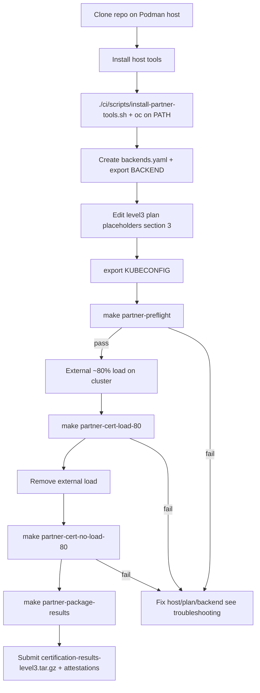
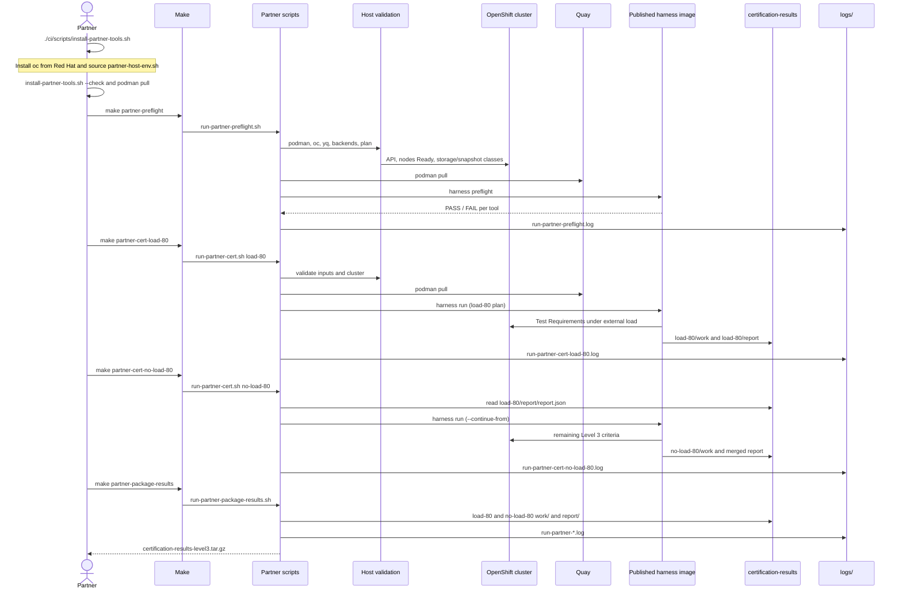
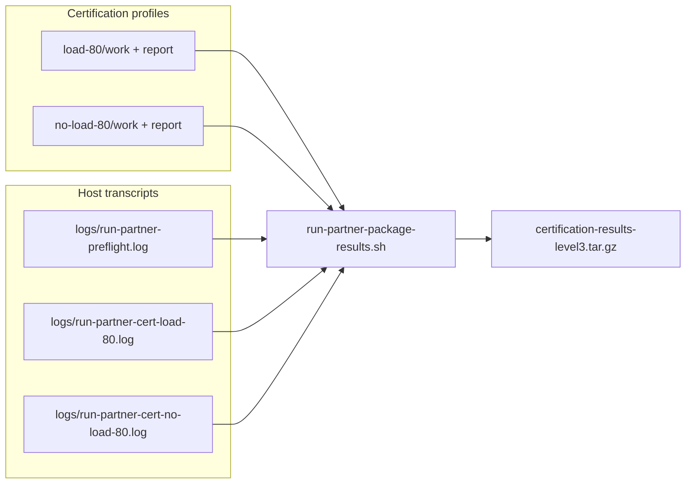

# OpenShift Virtualization CSI Partner Certification Guide

## Level 3: Performance Validated

This guide describes the end-to-end process for running the storage
certification harness and preparing the results for certification review.

All harness commands run in the published container image
[`quay.io/virtarraycert/storage-cert-harness:main`](https://quay.io/repository/virtarraycert/storage-cert-harness?tab=tags).
You do not need to build the harness locally. Clone this repository on the
machine that runs Podman so you can mount `catalog.json`, `thresholds.json`,
`plans/`, and your `backends.yaml` into the container.

The harness runs the Test Requirements selected by a test plan, collects tool
results, evaluates them against `thresholds.json`, and writes a certification
report.

## Workflow overview

High-level steps, then how `make partner-*` maps to host scripts, the published
image on Quay, and result directories. Install host tools from the cloned repo
before any `make partner-*` run (see [Prerequisites](#prerequisites)).



### Sequence: Make targets, wrappers, and published image

Each `make partner-*` target runs a script under `ci/scripts/`. Host checks run
on the workstation; harness work runs inside
`quay.io/virtarraycert/storage-cert-harness:main` via Podman.



### Flow: packaging Level 3 results

`make partner-package-results` archives both certification profiles and partner
helper logs into one tarball (requires completed load-80 and no-load-80 runs).



---

## Prerequisites

Run partner certification from a **Linux** or **macOS** workstation that can
reach your OpenShift API and pull images from Quay. Install host tools before
you clone the repository or run `make partner-*`.

### Supported platforms

| Platform | Support | Notes |
| --- | --- | --- |
| **Linux** (Fedora, RHEL, CentOS Stream, Rocky, Alma, Ubuntu, Debian) | **Supported** | Primary target for certification; use `dnf`/`apt` packages where noted below. |
| **macOS** (Apple Silicon or Intel) | **Partial** | `oc`, `yq`, and `jq` work; Podman typically needs [Podman Machine](https://podman.io/docs/installation#macos). Not validated for every certification workload. |
| **Windows** (native, CMD, PowerShell) | **Not supported** | Use a supported Linux VM or bare-metal host instead. WSL2 is not validated for partner runs. |

### Tools required by partner Makefile targets

The wrappers `./ci/scripts/run-partner-*.sh` (invoked by `make`) check host
tools before starting Podman. **`make partner-cert-no-load-80`** uses the same
host requirements as **`make partner-cert-load-80`**.

| Tool | `make partner-preflight` | `make partner-cert-load-80` | `make partner-package-results` | Role |
| --- | --- | --- | --- | --- |
| **git** | Clone repo (one-time) | — | — | Download this repository |
| **make** | yes | yes | yes | Invokes partner scripts |
| **bash** | yes | yes | yes | Scripts (`#!/usr/bin/env bash`) |
| **podman** | yes | yes | — | Pull and run the published harness image |
| **oc** | yes | yes* | — | API reachability, nodes `Ready`, storage/snapshot classes, plan nodes |
| **yq** | yes | yes | — | Parse `backends.yaml` and Level-3 plan overrides on the host |
| **tar** | — | — | yes | Build `certification-results-level3.tar.gz` |
| **curl** | — | — | — | Used only by the install script when downloading `yq` / `jq` binaries |

\* Set `SKIP_HOST_VALIDATE=true` only for exceptional debugging; normal
certification runs must keep host `oc` checks enabled.

**Recommended (not invoked by the scripts):**

| Tool | Purpose |
| --- | --- |
| **jq** | Inspect `oc … -o json` output and `report.json` on the host |
| **python3** | Optional local automation; partner `make` targets do not call Python |

### Obtain the repository

```bash
git clone <your-certification-git-url>/storage-cert-harness.git
cd storage-cert-harness
git checkout main   # default branch for Level 3 certification
```

Run certification on the **`main`** branch unless your Red Hat certification
contact directs you to a different branch or tag. All `make partner-*` commands
run from the **repository root**.

### Install host tools (automated script)

Partners should use the **partner** installer (not `make install-tools`, which
is for harness developers and requires Go):

```bash
cd storage-cert-harness
./ci/scripts/install-partner-tools.sh

# After installing oc manually:
export PATH="${HOME}/.local/bin:${PATH}"
./ci/scripts/install-partner-tools.sh --check
```

The script can install or verify **git**, **make**, **podman**, **yq**, and
**jq** (into `~/.local/bin` when needed). It prints guidance for **oc**, which
you must install from Red Hat (see below). It may use **python3** only to
report status; partner runs do not require Python.

Package management inside the installer: **podman** via **dnf** (Fedora/RHEL),
**apt** (Debian/Ubuntu), or **brew** (macOS); **yq** and **jq** via **curl**
into **`~/.local/bin` only** (per Linux/macOS user, not system-wide). The
installer **always** (re)downloads **yq** and **jq** there when those files are
missing, even if `/usr/bin/jq` or an old `yq` exists. Other users or shells do
not see them until you `export PATH` or run
`source ./ci/scripts/partner-host-env.sh` in that shell. To remove only the
partner copies, delete `~/.local/bin/yq` and `~/.local/bin/jq`, then run
`./ci/scripts/install-partner-tools.sh` again to restore them.

If **`./ci/scripts/install-partner-tools.sh` fails** (unsupported OS package manager,
no `sudo`, air-gapped host, or download errors), install each missing tool with
your platform’s packages or vendor binaries, then run `--check` again.

Red Hat engineers building the harness image may use
**`./ci/scripts/install-tools.sh`** (`make install-tools`).
That script installs CI scanners, linters, and related tooling and **requires
Go 1.26+**. If it fails, install the reported tools for your platform manually.
It is not the default path for storage partners running certification.

### Manual installation by platform

| Tool | Fedora / RHEL (`dnf`) | Ubuntu / Debian (`apt`) | macOS (`brew`) |
| --- | --- | --- | --- |
| git | `sudo dnf install -y git` | `sudo apt install -y git` | `brew install git` |
| make | `sudo dnf install -y make` | `sudo apt install -y make` | Xcode CLT or `brew install make` |
| podman | `sudo dnf install -y podman` | `sudo apt install -y podman` | `brew install podman` (+ `podman machine init`) |
| yq | `sudo dnf install -y yq` or partner script | `sudo snap install yq` or partner script | `brew install yq` or partner script |
| jq | `sudo dnf install -y jq` | `sudo apt install -y jq` | `brew install jq` |
| python3 | `sudo dnf install -y python3` | `sudo apt install -y python3` | `brew install python` |

### OpenShift CLI (`oc`)

`oc` is **required** for `make partner-preflight` and `make partner-cert-*`
unless you explicitly skip host validation (not for production certification).

1. Download the client that matches your cluster version from
   [OpenShift downloads](https://console.redhat.com/openshift/downloads) (or
   your cluster’s shipped `oc` binary).
2. Install it on your `PATH` and ensure it is executable.
3. Point certification at your cluster:

```bash
export KUBECONFIG=/absolute/path/to/kubeconfig
oc whoami --show-server
oc get nodes
```

**Troubleshooting `oc`:**

| Symptom | What to check |
| --- | --- |
| `oc: command not found` | Install `oc`; re-run `./ci/scripts/install-partner-tools.sh --check` |
| `error: cluster is not reachable` | VPN, firewall, wrong `KUBECONFIG`, expired token |
| `Unable to connect to the server` | API URL in kubeconfig; TLS trust (`oc login` or corporate proxy) |
| `storage class … does not exist` | Fix `backends.yaml`; `oc get storageclass` |
| `node … is not Ready` | Fix cluster health before certification |
| Permission errors on create | Kubeconfig user must manage namespaces, VMs, PVCs per plan |

### Verify prerequisites

The installer runs the same checks at the end of `./ci/scripts/install-partner-tools.sh`
and `./ci/scripts/install-partner-tools.sh --check` (version commands plus a short **yq**
/**jq** smoke test). You can repeat them manually:

```bash
# Prefer partner-host-env (PATH + clears stale bash hash to deleted /usr/bin/yq)
source ./ci/scripts/partner-host-env.sh

# Automated check + per-binary verification (exit 0 = ready)
./ci/scripts/install-partner-tools.sh --check

# Manual copy-paste verification (optional; mirrors the installer)
set -e
git --version
make --version
bash --version
podman --version
tar --version
test -x "${HOME}/.local/bin/yq"
"${HOME}/.local/bin/yq" --version
printf 'probe: partner-yq\n' | yq e -r '.probe' -
test -x "${HOME}/.local/bin/jq" && "${HOME}/.local/bin/jq" --version && echo '{}' | "${HOME}/.local/bin/jq" . >/dev/null
python3 --version   # optional
oc version --client

# Harness image
podman pull quay.io/virtarraycert/storage-cert-harness:main
```

Expected highlights:

| Check | Example success output |
| --- | --- |
| `yq e -r '.probe' -` | `partner-yq` (confirms [mikefarah/yq](https://github.com/mikefarah/yq), not distro `python-yq`) |
| `install-partner-tools.sh --check` | `verify ok all required partner tools` then `all required partner tools present` |
| `podman pull …` | Image layers download without auth errors |

If interactive `yq` fails with `/usr/bin/yq: No such file or directory` after you
removed a system package, bash is still using a **hashed** old path. Run
`source ./ci/scripts/partner-host-env.sh` (or `hash -r`) in that shell, then
`yq --version` again. `make partner-*` scripts source the same helper automatically.

When verification and `podman pull` succeed, continue with cluster preparation
(section 1) and the certification flow below.

---

### Pull and verify the harness image

On the host that will run certification, confirm you can pull the `main` image
from [Quay](https://quay.io/repository/virtarraycert/storage-cert-harness?tab=tags):

```bash
podman pull quay.io/virtarraycert/storage-cert-harness:main
```

> **Note:** We recommend using Podman as the container execution tool. If you
> encounter issues using Docker or Buildah, report them to us.

### Host logs (`logs/`)

Every partner harness command invoked through `make partner-*` or
`./ci/scripts/run-partner-*.sh` writes a **host-side** log under the
`logs/` directory at the repository root. The file captures validation,
`podman pull`, and all stdout/stderr from the wrapper and container for that
invocation.

| Command | Log file |
| --- | --- |
| `make partner-preflight` | `logs/run-partner-preflight.log` |
| `make partner-cert-load-80` | `logs/run-partner-cert-load-80.log` |
| `make partner-cert-no-load-80` | `logs/run-partner-cert-no-load-80.log` |

Before each run, an existing log with the same name is renamed with a UTC
timestamp (for example `logs/run-partner-preflight-20261022T120000Z.log`) so
the latest attempt is always the basename without a timestamp.

Inside the container, `harness run` also writes **`run.log`** under each
profile’s `certification-results/<profile>/report/` directory. For failures,
send both the host log in `logs/` and that profile’s `report/run.log`.

> **Note:** Run **only one harness execution at a time** on a given cluster
> (preflight, certification runs, or any other harness job). Concurrent runs
> against the same cluster are not supported. **This is currently your
> responsibility** to enforce.

### Certification flow (Level 3)

Use this sequence after the cluster and CSI driver are ready. Mermaid diagrams
for the full workflow are in **[Workflow overview](#workflow-overview)** at the
top of this guide. Details for each step are in the numbered sections below.

| Step | Command | Success signal |
| --- | --- | --- |
| 0 | Clone repo; `git checkout main` (Prerequisites) | Repository root with plans and `thresholds.json` |
| 1 | `./ci/scripts/install-partner-tools.sh`; install `oc`; `--check`; `podman pull` | `verify ok all required partner tools` |
| 2 | Prepare cluster (section 1) | CSI `StorageClass` / `VolumeSnapshotClass` healthy |
| 3 | `backends.yaml` + `export BACKEND=…` (sections 2–3) | Name matches plan usage via `BACKEND` only |
| 4 | Edit `plans/level3-customer-no-load-80.yaml` (section 3) | No `<…>` placeholders; TR-VIRT-010 `replicas` / `snapshot_count` set |
| 5 | `export KUBECONFIG=…` (sections 4–5) | `oc whoami` and `get nodes` succeed |
| 6 | `make partner-preflight` (section 7) | Exit 0; no `[FAIL]` lines in host log or container output |
| 7 | `make partner-cert-load-80` (section 8) | `certification-results/load-80/report/report.json` present |
| 8 | `make partner-cert-no-load-80` (section 8) | Merged report under `no-load-80/report/` |
| 9 | `make partner-package-results` (sections 9–11) | `certification-results-level3.tar.gz` created |
| 10 | Attestations if required (section 10) | Claims merged into final report when applicable |

---

## 1. Prepare an OpenShift cluster with a storage backend

Prepare a cluster that meets
[`docs/cluster-requirements.md`](docs/cluster-requirements.md):

- OpenShift Virtualization and CDI when required by the certification plan.
- The CSI driver for the array under test installed and healthy.
- A `StorageClass` for the CSI driver under test.
- A `VolumeSnapshotClass` backed by that driver when the plan requires snapshots.
- A filesystem-mode CDI scratch `StorageClass` for VM image and DataVolume workflows when required.

Follow [`docs/cluster-setup-guide.md`](docs/cluster-setup-guide.md) for detailed
cluster preparation.

---

## 2. Prepare the backends file

Create `backends.yaml` in the repository root with one backend entry:

Level 3 certification needs only four fields:

```yaml
schema_version: "1"
backends:
  - name: partner-storage
    storage_class: <storage-class-name>
    snapshot_class: <volume-snapshot-class-name>
```

Use the same `name` as `BACKEND` at run time (section 3). Class names must
match the cluster. Do not add other keys unless Red Hat asks for them.

---

## 3. Customize the Level 3 plans for your partner backend

Three steps: define `backends.yaml`, set `export BACKEND=<name>`, and edit
cluster placeholders in the two Level 3 plan files. Put `storage_class` and
`snapshot_class` only in `backends.yaml` — not in the plan.

**Before the first run:**

1. `BACKEND` matches the `name` in `backends.yaml`.
2. `storage_class` and `snapshot_class` exist in the cluster.
3. Node and snapshot placeholders in `plans/level3-customer-no-load-80.yaml`
   are filled in (below).

All `make partner-*` commands use `BACKEND` and `./backends.yaml` by default.
The shipped plans do not set `backend:`; every partner uses the same plan files.

### What to edit in the plan files (cluster layout)

Edit the shipped plans **in your clone** (same paths the Makefile uses). Do
not change `select.ids` or remove Test Requirements unless Red Hat instructs
you to run a reduced scope.

#### `plans/level3-customer-load-80.yaml` (80% load)

| Location | What to set |
| --- | --- |
| `overrides.TR-STOR-002` | `profile: load-80` is already set. |
| External load | You maintain ~80% load outside the harness during this run only. |

#### `plans/level3-customer-no-load-80.yaml` (no load)

Replace angle-bracket placeholders with values from **your** cluster. Use
worker node names from `oc get nodes` (nodes that will run VMs or be drained).

| Test | Plan field | Purpose |
| --- | --- | --- |
| TR-VIRT-007 | `overrides.TR-VIRT-007.node` | Worker targeted for failure / recovery (FAR). |
| TR-VIRT-007 | `overrides.TR-VIRT-007.far_config` | Leave `/far-config.json` unless Red Hat gives you a different mount path. |
| TR-VIRT-008 | `overrides.TR-VIRT-008.target_node` | Worker to drain for evacuation test. |
| TR-VIRT-013 | `overrides.TR-VIRT-013.node_name` | Worker used for single-node VM ceiling sweep. |
| TR-VIRT-010 | `overrides.TR-VIRT-010` | Uncomment / set `replicas` and `snapshot_count` per certification batch size. |

Example fragment after customization (names illustrative):

```yaml
overrides:
  TR-VIRT-007:
    mode: far-operator
    far_config: /far-config.json
    node: worker-2.example.com
  TR-VIRT-008:
    target_node: worker-1.example.com
    num_vms: 50
    start: 1
    end: 50
  TR-VIRT-013:
    node_name: worker-3.example.com
  TR-VIRT-010:
    replicas: 10
    snapshot_count: 10
```

Leave other `overrides` and `select.ids` as shipped unless Red Hat tells you
otherwise.

### Example

`backends.yaml`:

```yaml
schema_version: "1"
backends:
  - name: acme-afs-csi
    storage_class: acme-csi-sc
    snapshot_class: acme-csi-snapclass
```

```bash
export KUBECONFIG=/path/to/kubeconfig
export BACKEND=acme-afs-csi
```

Then edit node placeholders in `plans/level3-customer-no-load-80.yaml`.

### Preflight after customization

Run preflight against the **no-load** plan (widest tool surface) after backend
and plan edits:

```bash
export PLAN=plans/level3-customer-no-load-80.yaml
make partner-preflight
```

Host validation checks that `storage_class` / `snapshot_class` from
`BACKEND` exist in the cluster and that configured plan nodes exist.

---

## 4. Set kubeconfig in your environment

The harness uses the cluster credentials from `KUBECONFIG` on the host and
inside the container (the run scripts mount your kubeconfig read-only).

```bash
export KUBECONFIG=/path/to/kubeconfig
```

Use a kubeconfig whose identity can create namespaces, workloads, VMs, PVCs, and
snapshots as required by the selected plan.

---

## 5. Confirm you can access the cluster

On the same host that will run Podman, verify API access and node health:

```bash
oc --kubeconfig "$KUBECONFIG" whoami --show-server
oc --kubeconfig "$KUBECONFIG" get nodes
oc --kubeconfig "$KUBECONFIG" get storageclass <storage-class-name>
oc --kubeconfig "$KUBECONFIG" get volumesnapshotclass <volume-snapshot-class-name>
```

The partner helper scripts (`make partner-preflight`, `make partner-cert-*`)
perform the same connectivity and cluster-health checks (API reachable, every
node `Ready`, storage and snapshot classes from `backends.yaml` present) before
starting the container.

---

## 6. Required inputs (from this repository)

Clone the repository and run all commands from its root (example:
`/home/nlevanon/workspace/csi-betterment/storage-cert-harness`).

### Level 3 plans (fixed paths in the repo)

| Profile | Plan file |
| --- | --- |
| **80% load** (data-path under load) | `plans/level3-customer-load-80.yaml` |
| **No load** (all other Level-3 criteria) | `plans/level3-customer-no-load-80.yaml` |

The helper scripts and Makefile targets always use these paths. You do not pass
a different plan for certification unless you are debugging with manual
`podman run` invocations.

### Thresholds (one file for both runs)

Both the load-80 and no-load-80 runs grade against the **same**
`thresholds.json` at the **repository root** (next to `catalog.json`). The
container mounts that file as `--thresholds /inputs/thresholds.json`. Do not
copy or edit thresholds for partner runs; use the file shipped with the repo.

| File | Purpose |
| --- | --- |
| `catalog.json` | Test Requirement metadata and metric descriptors. |
| `thresholds.json` | SLA thresholds for **both** Level-3 runs. |
| `plans/level3-customer-load-80.yaml` | Load-80 certification plan. |
| `plans/level3-customer-no-load-80.yaml` | No-load certification plan. |
| `backends.yaml` | Your backend name, `storage_class`, and `snapshot_class`. |

The catalog and `thresholds.json` must come from the same export. The `run`
command validates their schema version, KB commit, and Test Requirement IDs.
`preflight` does not load `thresholds.json`; SLA gates are applied during
`run` only.

---

## 7. Run preflight

Set the backend name and run preflight (host checks + harness preflight in the
container):

```bash
export KUBECONFIG=/path/to/kubeconfig
export BACKEND=partner-storage

make partner-preflight
```

Or invoke the script directly:

```bash
./ci/scripts/run-partner-preflight.sh
```

### What preflight validates

Preflight is layered:

| Layer | What is checked |
| --- | --- |
| **Host (scripts)** | Podman and `oc` available; kubeconfig readable; API reachable; all nodes `Ready`; `storage_class` and `snapshot_class` from `backends.yaml` exist in the cluster; plan node placeholders that are set match real nodes. |
| **`backends.yaml` (harness)** | File parses; `schema_version`; backend name exists. |
| **Harness `preflight` (container)** | Per selected tool: binaries on image `PATH`; plan parameters; resolved `storage_class` from the backend; CRDs (KubeVirt, CDI, snapshots when needed); storage class present via `oc`/`kubectl` inside the container; snapshot class resolution when tests need snapshots. |

There is no separate check named `connectivity.cluster-health` in the harness
output. Connectivity and cluster health are covered by the host script checks
above and by tool preflight messages such as `storage class "…" present` and CRD
presence lines.

Preflight does **not** evaluate SLA numeric values in `thresholds.json`. Resolve
every `[FAIL]` preflight line before starting certification runs.

### Backend vs plan customization in preflight

Storage comes from **`BACKEND` and `backends.yaml`**, not from a `backend:` field
in the plan. A successful host check plus a harness log line like
`using backend name=… storage_class=…` means the backend is configured; you do
**not** need to copy storage class names into the plan.

If preflight fails after backend checks pass, the cause is usually an
**unchanged plan template** in `plans/level3-customer-no-load-80.yaml`, for example:

| Symptom in `logs/run-partner-preflight.log` | Fix in the plan |
| --- | --- |
| `TR-VIRT-010 parameters: param "replicas" must be >= 1` | Set `overrides.TR-VIRT-010.replicas` and `snapshot_count` (not `{}`). |
| `node_name "<TARGET_NODE_…>" is not a schedulable worker` | Replace `<TARGET_NODE_…>` and other `<…>` placeholders with real worker names. |
| `target_node=<TARGET_NODE_TO_DRAIN>` still in the log | Set `overrides.TR-VIRT-008.target_node` and `overrides.TR-VIRT-007.node`. |

Partner scripts validate the no-load plan on the host before `podman pull` when
placeholders or missing TR-VIRT-010 parameters remain. For a full list of host
and preflight failure patterns, see **section 13**.

To use a different plan for preflight tool selection:

```bash
export PLAN=plans/level3-customer-load-80.yaml
make partner-preflight
```

---

## 8. Run the two certification profiles

Level 3 certification uses two runs. Each run uses root `thresholds.json`, the
same `BACKEND` / `backends.yaml` as preflight, and the plan named in section 6:

1. **Load profile** — `plans/level3-customer-load-80.yaml` while the cluster is
   under sustained external load (~80). The partner operates the load mechanism.
2. **No-load profile** — `plans/level3-customer-no-load-80.yaml` after load is
   removed. Pass the first run’s `report.json` with `--continue-from` so the
   second report merges both runs.

Use separate output trees. Helper scripts archive any previous
`certification-results/<profile>/` directory with a UTC timestamp before each
run (disable with `PARTNER_KEEP_WORK=true`).

```bash
export KUBECONFIG=/path/to/kubeconfig
export BACKEND=partner-storage

# Run 1 — maintain external load during this run.
make partner-cert-load-80

# Stop or remove external load, then Run 2.
make partner-cert-no-load-80
```

Default result layout:

```text
certification-results/
├── load-80/
│   ├── work/          # tool workdir (--workdir)
│   └── report/        # report.json, report.md, report.junit.xml, run.log, …
└── no-load-80/
    ├── work/
    └── report/        # merged certification report
```

The no-load script expects the prior report at
`certification-results/load-80/report/report.json` unless you set
`CONTINUE_FROM`.

### Manual container invocation

Equivalent to the Makefile targets (image tag `main` on
[Quay](https://quay.io/repository/virtarraycert/storage-cert-harness?tab=tags)):

```bash
HARNESS_IMAGE=quay.io/virtarraycert/storage-cert-harness:main
LOAD_REPORT=certification-results/load-80/report
NO_LOAD_REPORT=certification-results/no-load-80/report
mkdir -p "$LOAD_REPORT" "$NO_LOAD_REPORT/work" "$NO_LOAD_REPORT/report"

podman pull "$HARNESS_IMAGE"

# Run 1 (load-80) — mount plans and inputs; see run-partner-cert.sh for full flags.
# Run 2 (no-load-80) — add read-only mount of load-80 report dir and:
#   --continue-from /prior-load/report.json
```

Use a fixed image tag instead of `:main` when your certification instructions
pin a specific version.

---

## 9. Collect output (work, report, and logs)

Each profile writes **two** directories under `certification-results/<profile>/`.
Keep **all files** in both trees for submission and troubleshooting.

| Directory | Contents |
| --- | --- |
| `.../report/` | `report.json`, `report.md`, `report.junit.xml`, `run.log`, and any report-side artifacts the harness writes. |
| `.../work/` | Tool workdir output (kube-burner / virtbench result files, variant subdirs, and other files created during the run). |

After **load-80**:

```text
certification-results/load-80/report/   ← reports and run.log
certification-results/load-80/work/     ← all tool artifacts
```

After **no-load-80**:

```text
certification-results/no-load-80/report/   ← merged certification report + run.log
certification-results/no-load-80/work/     ← all tool artifacts
```

Package everything (both profiles, both `work/` and `report/` trees, plus helper
logs under `logs/`):

```bash
make partner-package-results
# creates certification-results-level3.tar.gz
```

| Output | Contents |
| --- | --- |
| `certification-results-level3.tar.gz` | `load-80` and `no-load-80` each `work/` + `report/`; `logs/run-partner-*.log` |

Set `PARTNER_PACKAGE_LOGS=false` to omit host helper logs from the tarball.
Set `CERT_RESULTS_ROOT` if results are not under `./certification-results`.

Packaging fails if either profile is missing a `work/` or `report/` directory
(see **Packaging errors** in troubleshooting).

### If a run fails or exits non-zero

Collect evidence in this order (full detail in **Error tracking and
troubleshooting**):

1. **`certification-results/<profile>/report/run.log`** — harness and tool output
   for that profile.
2. Matching host log: **`logs/run-partner-preflight.log`**,
   **`logs/run-partner-cert-load-80.log`**, or
   **`logs/run-partner-cert-no-load-80.log`**.
3. **`report.json`**, **`report.junit.xml`**, and **`report.md`** under the same
   `report/` directory when they exist.
4. For a complete bundle after both runs (or partial when Red Hat asks):
   **`certification-results-level3.tar.gz`** from `make partner-package-results`.

A non-zero exit can mean failed certification criteria; reports and logs are
still written under `report/` and should be included in what you send to Red
Hat.

---

## 10. Provide attestations

Attestations are self-reported claims the harness cannot measure from the
cluster. You may skip them during `run` (`--no-attestations` in the helper
scripts) and add them later:

```bash
podman run --rm \
  -v "$PWD/attestations.json:/inputs/attestations.json:ro,Z" \
  -v "$NO_LOAD_REPORT:/results:Z" \
  "$HARNESS_IMAGE" attest \
    --report /results/report.json \
    --attestations /inputs/attestations.json \
    --output /results
```

See the attestations JSON shape in the previous revision of this guide or run
`harness attest --help` in the image. When `--continue-from` carries
attestations from the first report, they are merged into the final report.

---

## 11. Create the submission archive

**Minimum JUnit + run log** (when Red Hat asks only for graded results):

```bash
LOAD_DIR=certification-results/load-80/report
NO_LOAD_DIR=certification-results/no-load-80/report

test -s "$LOAD_DIR/report.junit.xml"
test -s "$LOAD_DIR/run.log"
test -s "$NO_LOAD_DIR/report.junit.xml"
test -s "$NO_LOAD_DIR/run.log"

tar -czf certification-results-junit.tar.gz \
  -C certification-results \
  load-80/report/report.junit.xml \
  load-80/report/run.log \
  no-load-80/report/report.junit.xml \
  no-load-80/report/run.log
```

**Full output** (all files under every `work/` and `report/` directory):

```bash
make partner-package-results
```

Submit the archive your Red Hat certification contact requests
(`certification-results-junit.tar.gz`, `certification-results-level3.tar.gz`, or
both).

---

## 12. Certification result

Review uses the selected plan, catalog joined with `thresholds.json`, JUnit
results, and run logs. A successful harness run does not by itself grant
certification; Red Hat reviews the submission against applicable requirements.

---

## 13. Error tracking and troubleshooting

Missing host tools (`podman`, `oc`, `yq`, `make`) usually fail before any
container starts; see **Prerequisites** and re-run
`./ci/scripts/install-partner-tools.sh --check`.

Partner runs produce **three layers** of evidence. Use them together to find
whether a failure happened before the container started, during harness
preflight, or during a certification `run`.

| Layer | Where to look | What it captures |
| --- | --- | --- |
| **Host validation** | `logs/run-partner-*.log` (start of file) | `podman` / `oc` / `yq` checks; `BACKEND`; cluster API; nodes `Ready`; storage and snapshot classes; plan placeholders (no-load plan) |
| **Harness in container** | Same log (after `==> harness preflight` or `==> harness run`) | Tool preflight `[FAIL]` / `[PASS]`; backend resolution; CRDs; per-TR execution |
| **Profile artifacts** | `certification-results/<profile>/report/` | `run.log` (duplicate of in-container stream for `run`), `report.json`, JUnit, graded criteria |

Archived logs and result trees: before each partner command, an existing
`logs/run-partner-<name>.log` or `certification-results/<profile>/` directory
is renamed with a UTC timestamp so the latest attempt keeps the short name.
Search older `*-20261022T…` siblings when comparing retries.

### Quick triage by stage

| Stage | Symptom | First file to open |
| --- | --- | --- |
| Before `podman pull` | Immediate `error:` on stderr; make exits in seconds | `logs/run-partner-preflight.log` or `logs/run-partner-cert-*.log` |
| After pull, preflight | `[FAIL]` lines; exit non-zero | Same host log + search for first `[FAIL]` |
| Certification `run` | Long run then non-zero | `certification-results/<profile>/report/run.log` then host log tail |
| Packaging | `error: incomplete level3 results` | Run missing profile (`make partner-cert-load-80` / `no-load-80`) |

### Host script errors (before the container)

These appear as `error:` lines in the host log. The wrapper exits before
`podman pull` unless noted.

| Message (pattern) | Cause | Fix |
| --- | --- | --- |
| `set BACKEND to the name of your entry` | `BACKEND` unset or wrong | `export BACKEND=<name>` matching `backends.yaml` |
| `podman is required` | Podman not installed or not on `PATH` | Install Podman; use the host recommended in this guide |
| `oc is required for cluster connectivity` | OpenShift CLI missing | Install `oc`; same host as `KUBECONFIG` |
| `kubeconfig is missing or unreadable` | Bad `KUBECONFIG` path | `export KUBECONFIG=/absolute/path`; file mode readable |
| `cluster is not reachable` | API down, wrong context, or TLS | `oc --kubeconfig "$KUBECONFIG" whoami`; fix VPN/firewall/certs |
| `node '…' is not Ready` | Worker not ready | `oc get nodes`; fix machine / CNI before cert runs |
| `storage class '…' from backends does not exist` | Wrong `storage_class` in `backends.yaml` | `oc get storageclass`; fix spelling and driver |
| `volume snapshot class '…' … does not exist` | Wrong `snapshot_class` | `oc get volumesnapshotclass` |
| `backend '…' is not defined` / `has no storage_class` | Invalid `backends.yaml` | Section 2; install `yq` if validation asks for it |
| `plan still has placeholders` | Angle-bracket strings in no-load plan | Section 3; host lists each placeholder line |
| `set overrides.TR-VIRT-010.replicas` / `snapshot_count` | TR-VIRT-010 still `{}` or zero | Set both fields `>= 1` in the no-load plan |
| `plan node '…' does not exist` | Typo in `node` / `target_node` / `node_name` | `oc get nodes`; use exact worker names |
| `no-load-80 requires a prior load-80 report` | Run 2 before Run 1 or archived results | Complete `make partner-cert-load-80` first, or set `CONTINUE_FROM` to `report.json` path |
| `catalog missing` / `thresholds missing` / `plan missing` | Repo incomplete or wrong cwd | Run from repository root; do not delete shipped `catalog.json` / `thresholds.json` / `plans/` |

### Harness preflight `[FAIL]` (inside the container)

Host checks can pass while harness preflight still fails. Scroll the host log
to the container section or grep for `[FAIL]`.

| Typical `[FAIL]` theme | Usually means | Fix |
| --- | --- | --- |
| `TR-VIRT-010 parameters` / `replicas` | Plan overrides not applied | Section 3; re-run after editing no-load plan |
| `node_name` / `target_node` / schedulable worker | Placeholder or control-plane node | Real worker names from `oc get nodes` |
| Storage class / snapshot class (harness wording) | Class not visible inside container | Same as host class checks; driver must be cluster-scoped |
| Missing CRD (KubeVirt, CDI, snapshot) | Feature not installed | `docs/cluster-requirements.md` |
| Tool binary / parameter errors | Plan `overrides` incompatible with cluster | Read the full `[FAIL]` line; adjust overrides per TR docs |

Preflight does **not** read SLA numbers from `thresholds.json`. A preflight
pass does not guarantee certification pass.

### Certification run failures

| Symptom | Check |
| --- | --- |
| Exit non-zero but `report.json` exists | Open `report.json` / JUnit for failed criteria; send `run.log` + host log |
| Run killed or disk full mid-run | Host log tail; free space under `certification-results/…/work/` |
| Load-80 passed; no-load fails immediately on host | `CONTINUE_FROM` path; ensure `load-80/report/report.json` not archived away |
| Podman volume / mount errors | Scripts use **absolute** paths for `work/` and `report/`; run from repo root; do not substitute relative `-v` paths manually |

For load-80, maintain external ~80% load for the **entire** `partner-cert-load-80`
window. Removing load early can fail storage criteria even when the harness exits cleanly.

### Packaging errors

| Message | Cause | Fix |
| --- | --- | --- |
| `incomplete level3 results; missing:` | One profile never run or only `report/` without `work/` | Run both `make partner-cert-load-80` and `make partner-cert-no-load-80` |
| `hint: run make partner-cert-load-80 and … no-load-80` | Same as above | Complete section 8 before `partner-package-results` |
| `nothing to package for mode=level3` | Empty `certification-results/` | Run certification profiles first |

### What to send Red Hat (failure or evidence)

Minimum for a **single failed profile**:

- `certification-results/<profile>/report/run.log`
- `logs/run-partner-cert-<profile>.log` (or preflight log if failure was there)
- `report.junit.xml` and `report.json` when present

Preferred **full Level 3 submission**:

- `certification-results-level3.tar.gz` from `make partner-package-results`
- Attestations when your program requires them (section 10)

Include the **image tag** you used (`HARNESS_IMAGE` or default
`quay.io/virtarraycert/storage-cert-harness:main`) and the git commit or tag of
this repository clone if you customized plans.

---

## Makefile reference (partner)

| Target | Purpose |
| --- | --- |
| `make partner-preflight` | Host + harness preflight |
| `make partner-cert-load-80` | Load-80 certification run |
| `make partner-cert-no-load-80` | No-load run with `--continue-from` |
| `make partner-package-results` | Level 3 bundle → `certification-results-level3.tar.gz` |

| Variable | Used by | Purpose |
| --- | --- | --- |
| `KUBECONFIG` | All partner targets | Cluster credentials (mounted read-only) |
| `BACKEND` | All | Name of entry in `backends.yaml` (required) |
| `BACKENDS` | Scripts | Path to backends file (default `backends.yaml`) |
| `HARNESS_IMAGE` | Scripts | Override Quay image (default `:main` on virtarraycert repo) |
| `PLAN` | Preflight (and host validation for that plan) | Default `plans/level3-customer-no-load-80.yaml` |
| `CERT_RESULTS_ROOT` | Cert + package | Results base dir (default `certification-results`) |
| `CONTINUE_FROM` | `no-load-80` only | Prior `report.json` (default load-80 report path) |
| `PARTNER_KEEP_WORK` | Cert + preflight logs | When `true`, skip archiving prior results/logs |
| `SKIP_HOST_VALIDATE` | Cert only | When `true`, skip host `oc` checks (not for production cert) |
| `PARTNER_PACKAGE_LOGS` | Package script | Include `logs/run-partner-*.log` (default `true`) |

Host execution logs: see **Host logs (`logs/`)** at the top of this guide.
Troubleshooting: section **13**.
