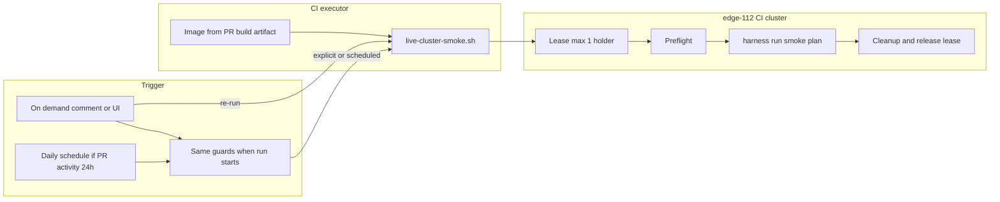

# Storage certification harness — CI/CD live cluster smoke test

## Status

In progress (2026-10-12 proposed; 2026-10-14 PR smoke, edge-112, lease; **2026-10-21**
implementation on `smoke-plan-single` — local smoke path largely wired; cluster
lease and CI live smoke still pending). See [§13 Implementation progress](#13-implementation-progress).

## Summary

Define how the `storage-cert-harness` repository runs **live-cluster smoke**
against the CI OpenShift lab (initial target: **edge-112**) using
`plans/harness-smoke-plan.yaml` with **minimal overrides** (VM counts, iterations,
timeouts) and portable CI scripts (`run-image-tests.sh`, `live-cluster-smoke.sh`).

The smoke plan covers **all non-destructive automated TRs** in `catalog.json`
(**excluding HA** / `TR-VIRT-007` and any TR that exceeds **20 minutes** at smoke
settings after tuning). **At most one smoke run may use the cluster at a time**;
there is **no queue** — a second run fails fast if the lease is held.

**Team trigger model (decided):**

- **No automatic smoke** on PR open, push to `main`, or the default `CI` workflow.
- Smoke runs only when explicitly requested:
  - **On demand:** PR comment `/run-live-smoke` (trusted association), or
    `workflow_dispatch` with PR number (Actions UI / allowed environment actors).
  - **Scheduled:** once daily (`05:00 UTC`); runs only if at least one **open**
    same-repo PR to `main` was **updated** in the **last 24 hours** and does not
    contain `[skip live-smoke]`.
- When a run is scheduled, the **same guards** apply as on-demand: canonical repo,
  same-repo head, skip token, fork rejection, cluster lease, environment secrets
  (path-filter rules in §1 remain policy for when smoke is *required* before merge,
  not a separate automatic trigger).
- Contributors **must** run the smoke plan at least once on a **personal /
  dedicated non-CI lab** before opening a PR when their diff would require smoke
  at merge time (documented in `README.md` and `docs/contributing.md`).
- **Failed PR smoke is a merge gate:** the live-smoke check must **pass** before
  the PR can merge. Investigate failures (logs, `report.json`, artifacts), fix or
  re-run on demand (§1.4) — do not merge with a failed smoke run. `[skip
  live-smoke]` is only for when the dedicated storage/cluster is **unavailable**
  (smoke not scheduled), not to bypass a failed run.
- Changes to **`go.mod` / `go.sum` / `vendor/**` alone do not trigger** smoke.

Measure **per-TR and full-suite** duration on edge-112 before locking CI
overrides. Image build/publish on `main` stays on the existing `ci-images` /
`ci-publish` path.

## Architecture overview



**Building blocks:** smoke plan and thresholds (today:
`plans/harness-smoke-plan.yaml`, `thresholds-smoke.json`; target bundle:
`ci/config/smoke/` — §6.5), `ci/scripts/run-harness/run-image-tests.sh`,
`ci/scripts/stage-smoke-config.sh` (to add — §6.6),
`ci/scripts/run-harness/live-cluster-smoke.sh` (scaffold), offline `run-harness/replay-smoke.sh` (not a
substitute for live smoke).

## Goals and non-goals

| Goals                                                                                        | Non-goals                                                      |
| -------------------------------------------------------------------------------------------- | -------------------------------------------------------------- |
| Catch regressions across **all** catalog automations (smoke scale) on a real OCP+CNV cluster | Full Level-3 certification scale or HA/fencing (`TR-VIRT-007`) |
| Run on contributor on-demand and optional daily schedule when open PRs had activity in 24h | Running on every PR commit, on PR open, or on push to `main` |
| Exclusive, safe use of a shared or dedicated CI cluster                                      | Storing real threshold bars or kubeconfig in git               |
| Deterministic preflight, minimal plan params, cleanup on all exit paths                      | Publishing graded reports with partner SLA secrets             |

## Related work and Jira traceability

| Jira                                                                   | Summary                                         | Design coverage                                                      |
| ---------------------------------------------------------------------- | ----------------------------------------------- | -------------------------------------------------------------------- |
| [ECOPROJECT-5406](https://redhat.atlassian.net/browse/ECOPROJECT-5406) | Live cluster smoke (Jira text may still say post-merge) | PR smoke + edge-112; update Jira to match §1 |
| [ECOPROJECT-5462](https://redhat.atlassian.net/browse/ECOPROJECT-5462) | Hosted runners for cluster smoke                | Section 2 — **optional**; see **When ECOPROJECT-5462 is not needed** |
| [ECOPROJECT-5536](https://redhat.atlassian.net/browse/ECOPROJECT-5536) | Opt-out: skip live smoke from PR / merge commit | Section 1 — **Skip live smoke**; `docs/ci.md`, PR template           |

### ECOPROJECT-5536: skip live smoke on demand

[Jira: ECOPROJECT-5536](https://redhat.atlassian.net/browse/ECOPROJECT-5536) —
sub-task of [ECOPROJECT-5488](https://redhat.atlassian.net/browse/ECOPROJECT-5488).
Long smoke should not block every `main` push (~2+ hours end-to-end when smoke
runs). Documented in `storage-cert-harness/docs/ci.md` and
`.github/pull_request_template.md`.

#### Scope

- Recognize an opt-out token in the **commit message** that lands on `main` (squash
merge commit message = PR title/body — document where contributors put the token).
- Skip the `live-smoke` job only; lint, unit test, build, image scan, and publish
continue unchanged unless a separate gate says otherwise.
- Emit a clear log line and GitHub check conclusion **Skipped** (not **Success**),
and surface skip in the workflow summary (SHA, actor, token used).
- Restrict who may skip (optional): only org members, or require `storage-cert-harness`
maintainer — fork pushes to `main` are already impossible on protected branches.

#### Acceptance criteria

- PR title/body containing `[skip live-smoke]` does not start cluster work.
- On-demand and scheduled workflows respect the skip token; no workflow runs smoke on PR open.
- Token is case-sensitive and documented in `docs/ci.md` and PR template.
- Skipped runs do not hold the cluster lease.
- Audit: workflow run records `live_smoke_skipped=true` in the summary for later
nightly or manual smoke backlog.

**Suggested tokens** (pick one in implementation): `[skip live-smoke]` primary;
avoid reusing `[skip ci]` (too broad).

### Drift from ECOPROJECT-5406 description (AC implied in story body)

The Jira description still references `plans/virtbench-bootstorm-live-smoke.yaml` and
a boot-storm-only smoke. Implementation and this design use an expanded
`plans/harness-smoke-plan.yaml` aligned with
`plans/level3-internal-minimal.yaml` (all catalog TRs, smoke overrides) but
**without** `TR-VIRT-007`. Image build/push is already implemented via GitHub
Actions / GitLab CI, not a single combined shell script named `ci/live-smoke.sh`.
The design keeps **portable scripts** under `storage-cert-harness/ci/scripts/`
(e.g. extend `run-image-tests.sh` or add `live-cluster-smoke.sh`) so GitLab and
GitHub share one entry point.

### When ECOPROJECT-5462 is not needed

[ECOPROJECT-5462](https://redhat.atlassian.net/browse/ECOPROJECT-5462) targets
**GitHub-hosted runners** that can reach the cluster, with triggers on **PR →**
`main` and explicitly **not** on push to `main`. That conflicts with the
historical post-merge-only lean; this design adopts **PR-open smoke** (see §1).

Treat ECOPROJECT-5462 as **out of scope** when either:

- Smoke runs on a **GitLab runner** (or other internal executor) that already has
network path to the cluster and `podman`/`oc`, or
- GitHub Actions uses a **self-hosted runner** or **runner group** with cluster
access, while default `ubuntu-latest` jobs stay unchanged.

In those cases, only ECOPROJECT-5406-style work is required: secrets, workflow
job, path filters, and cluster lease/cleanup. No separate “hosted runner”
product configuration story is needed; document runner owner and network path in
the ops runbook instead.

### ECOPROJECT-5462 acceptance criteria vs this design

| ECOPROJECT-5462 AC                         | This design                                                                                               |
| ------------------------------------------ | --------------------------------------------------------------------------------------------------------- |
| Hosted runner used only for cluster smoke  | Satisfied by dedicating a runner label / GitLab tag to the live-smoke job only                            |
| PR targeting `main` can run smoke on demand / schedule | **Adopted** — no PR-open auto-run; **required** merge gate on failure when check runs |
| Push to `main` does not run smoke          | **Adopted** — no push trigger; optional daily schedule only with 24h PR activity       |
| PR to non-`main` branch does not run smoke | Satisfied                                                                                                 |
| Fork PRs cannot read cluster secrets       | Satisfied via protected environments / `main`-only workflows / no `pull_request` trigger for live smoke   |
| Named owners, rotation, escalation         | Section 3 and **Operations**                                                                              |

---

## 1. When to trigger CI/CD smoke

### Event (team decision)

| Event | Run live smoke automatically? | Notes |
| --- | --- | --- |
| `pull_request` → `main` (any type) | **No** | No automatic smoke on open or new commits |
| Contributor **on demand** (`/run-live-smoke`, `workflow_dispatch`) | Yes when allowed | [§1.4](#14-contributor-on-demand-smoke-on-a-pr) |
| **`schedule`** (daily) | **Conditional** | Only if an open same-repo PR to `main` was updated in the last 24h and not skipped |
| Push to `main` | **No** | Lint/build/publish only |
| `workflow_dispatch` | On demand | `pr_number` only (SHA resolved on `ubuntu-latest` before self-hosted checkout) |
| Fork PR → upstream | **No** | No upstream kubeconfig |

**Merge gate:** PR live-smoke is a **required** status check on pull requests to
`main` (branch protection). A **failed** workflow run **blocks merge** until the
contributor investigates the failure, fixes the branch if needed, and a **passing**
re-run is recorded (on-demand §1.4). Treat failures as release blockers for that
PR — not post-mortem-only. Configure GitHub branch rules to require the
`live-smoke` (or workflow) check name once the job exists.

**Frequency:** Opening a PR triggers **at most one** automatic smoke. Pushing
additional commits to the PR branch does **not** trigger another automatic run;
contributors re-run smoke via comment or Actions UI when they need it.

### Forks and untrusted repositories

Live smoke must **never** run from a fork or expose upstream cluster secrets to
fork workflows. Required behavior:

| Scenario | Live smoke | `CI_CLUSTER_KUBECONFIG` / live-smoke secrets |
| --- | --- | --- |
| PR from a **fork** into upstream `main` | **Not triggered** (no `pull_request` trigger on live-smoke workflow) | **Not available** — GitHub does not pass upstream secrets to `pull_request` workflows for fork PRs |
| Push to **fork** `main` (copy of the repo) | **Not triggered** — job `if` requires canonical repository (below) | **Not available** — only secrets defined on the fork exist; upstream kubeconfig is never injected |
| Push to **upstream** `main` | No automatic smoke | N/A for default pipeline |
| Same-repo PR on demand | Yes when allowed | `environment: live-smoke` on upstream |
| Daily schedule | Yes only if open same-repo PR updated in last 24h (and not skipped) | Environment-gated |
| `workflow_dispatch` on upstream | Contributors with env access | Environment-gated |

**Implementation guards (GitHub):**

1. **Separate workflow** `ci-live-smoke.yml` with:
   - **`workflow_dispatch`** (PR number input) and **`issue_comment`** `/run-live-smoke`
     for on-demand runs — [§1.4](#14-contributor-on-demand-smoke-on-a-pr);
   - **`schedule`** (daily): smoke only when an open same-repo PR to `main` was
     updated in the last 24 hours and is not `[skip live-smoke]`;
   - **no** `pull_request`, **no** `push` to `main` for smoke.
   **Never** `pull_request_target` with secrets to execute fork-supplied code.
2. **Repository and same-repo guard:**

   ```yaml
   if: >-
     github.repository == 'openshift-storage-cert/storage-cert-harness' &&
     # same-repo PR resolved via Pulls API in resolve-* jobs; reject fork heads
     !contains(pr.title, '[skip live-smoke]') &&
     !contains(pr.body, '[skip live-smoke]')
   ```

   Adjust the string if the canonical GitHub org/repo name changes; document the
   value in `docs/ci.md`.
3. **Environment `live-smoke`** — store `CI_CLUSTER_KUBECONFIG`,
   `HARNESS_THRESHOLDS_JSON`, and `HARNESS_BACKENDS_YAML` as **environment
   secrets**, not plain repo secrets exposed to every workflow. Restrict
   deployment branches limited to upstream (PR jobs use environment only when
   same-repo PR rules are satisfied).
4. **Do not** pass cluster secrets via `secrets: inherit` on the top-level `CI`
   workflow for fork-visible jobs; the live-smoke reusable workflow (if any)
   should reference `environment: live-smoke` only on the guarded job.
5. **Self-hosted runner** `storage-cert-smoke` — register only on the upstream
   org; do not attach cluster-capable runners to public fork copies.

**GitLab (internal):** use protected + masked variables and `rules` so live-smoke
runs only on the canonical project’s protected `main`; fork MRs do not receive
protected cluster variables.

**Verification:** open a test PR from a personal fork — upstream `CI` lint/test/build
may run, but **no** `live-smoke` job appears and no workflow step receives
kubeconfig. Push to a fork’s `main` — same (no smoke job or job skipped with
“wrong repository”).

### Path filter (relevant changes only)

Run live smoke when **any** included path changes between the previous `main`
commit and `HEAD`. Skip the job entirely when the diff touches only excluded
paths.

**Include** (executable / packaged-tool impact):

| Path pattern                                                                                                            | Reason                                  |
| ----------------------------------------------------------------------------------------------------------------------- | --------------------------------------- |
| `cmd/**`, `internal/**`                                                                                                 | Harness logic, orchestration, tools     |
| `catalog.json`, `thresholds.json`                                                                                       | Test definitions and grading inputs     |
| `Containerfile`, `ci/config/images.env`, `ci/config/images.sh`                                                          | Runtime image composition               |
| Builder / tool pins that change image contents (e.g. `BUILD_IMAGE`, packaged tool versions in Containerfile build-args) | “Harness-builder image (packaged tool)” |
| `schemas/**`                                                                                                            | Plan/report validation behavior         |

**Exclude** (do not trigger live smoke alone):

| Path pattern                                                | Reason                                                                                                             |
| ----------------------------------------------------------- | ------------------------------------------------------------------------------------------------------------------ |
| `docs/**`, `*.md` (except if co-changed with include paths) | Documentation                                                                                                      |
| `ci/scripts/**`, `.github/**`, `.gitlab-ci.yml`             | CI wiring — unless paired with include paths in the same push                                                      |
| `plans/**`                                                  | Plan-only edits (smoke plan is versioned but stable; changing overrides without code should not burn cluster time) |
| `decisions/**`, `okf/**`, `skills/**`, `AGENTS.md`          | Process / KB metadata                                                                                              |
| `go.mod`, `go.sum`, `vendor/**`                             | **Dependency-only** — do **not** trigger live smoke (unit test + image build still run on PR)                      |

**Implementation notes:**

- GitHub: `paths` / `paths-ignore` on a dedicated workflow, or a first-step
`dorny/paths-filter` (or equivalent) job that sets `run_live_smoke=true`.
- GitLab: `rules:changes` with the same globs.
- If a single commit mixes doc and code changes, **run** smoke (include wins).

### Relationship to image build

- **Default:** live smoke `needs` successful `image-build` artifact for the same
SHA (load `dist/harness-image.tar` or use image tag `${NEXT-IMAGE-VERSION}` for
that commit).
- **Exception:** if only `Containerfile` / builder pins change and binary is
unchanged, still rebuild image — smoke validates the **image** that partners run.

### Skip live smoke (`[skip live-smoke]`)

Full-catalog smoke can take **hours** (see §7). The case-sensitive token
`[skip live-smoke]` in the **PR title or body** skips scheduling live smoke for
that PR (automatic and on-demand workflows must respect it).

| Mechanism | Behavior |
| --- | --- |
| PR title/body contains `[skip live-smoke]` | No live-smoke job scheduled; **merge allowed without smoke** — lab outage/maintenance only; record `live_smoke_skipped=true` |
| Dedicated storage/cluster **down** or lease unavailable | Use skip token; backlog manual smoke when the lab returns — **not** for hiding harness failures |
| Smoke job **failed** (harness error/fail verdict) | **Blocks merge** until fixed and a **passing** on-demand re-run |
| No token, smoke passes | Merge allowed when other required checks pass |

**Policy:** Skipping is for maintenance, lab outages, or emergencies — not routine.
PR template documents the token ([ECOPROJECT-5536](https://redhat.atlassian.net/browse/ECOPROJECT-5536)).
Skipped runs **never** acquire the cluster lease.

### 1.4 Contributor on-demand smoke on a PR

There is **no** automatic smoke when a PR is opened. Contributors (or maintainers)
request smoke explicitly:

| Mechanism | Suggested implementation | Who |
| --- | --- | --- |
| **PR comment** | `/run-live-smoke` on `issue_comment` where `issue.pull_request` is set; bot/workflow validates same-repo + not `[skip live-smoke]` + lease free | Contributors with `write` or `maintain` on repo (tune in workflow) |
| **GitHub CLI** | `gh pr comment <PR> --repo openshift-storage-cert/storage-cert-harness --body '/run-live-smoke'` | Same as PR comment (triggers `issue_comment` workflow) |
| **GitHub UI** | `workflow_dispatch` with input `pr_number` (no free-form `git_ref`) | Same; link run in PR summary |
| **Daily schedule** | `05:00 UTC` cron when an open same-repo PR had activity in the last 24h | Same guards; `max-parallel: 1` on cluster |

**Guards (all on-demand paths):**

- `github.event.pull_request.head.repo.full_name == github.repository` (no fork).
- Path filter optional for re-runs (often **always** allow re-run when explicitly requested).
- If lease acquire fails → job fails fast with “cluster busy” (**no queue** — §2).
- Set `live_smoke_on_demand=true`, PR number, SHA, actor in workflow summary.

**Fork PRs:** comment and UI triggers are **no-ops** (no secrets, no cluster access).

### 1.5 Contributor responsibility (local lab, non-CI cluster)

Before opening a PR that matches CI smoke **path includes** (§1 path filter —
excluding `vendor`/`go.mod`-only diffs), the author **must** run
`plans/harness-smoke-plan.yaml` at least once against a **dedicated lab cluster
they control** (personal or team lab kubeconfig — **not** the CI edge-112 lease
cluster). Document the run in the PR test plan (pass/fail, date, cluster name if
not sensitive).

| | CI shared lab (edge-112) | Contributor lab |
| --- | --- | --- |
| Purpose | On-demand + optional daily schedule (24h PR activity) | Pre-PR validation required by policy |
| Access | `live-smoke` environment secrets | Contributor `KUBECONFIG` + `work/backends.local.yaml` |
| Entry point | GHA / GitLab | `make build` + `make image-build-local` + `make run-harness-smoke` |

This does not replace unit tests or replay-smoke; it catches integration issues
before consuming shared CI cluster time.

**Illustrative comment trigger** (on-demand re-run; must not run for fork PRs or
untrusted commenters):

```yaml
on:
  issue_comment:
    types: [created]

permissions:
  contents: read
  pull-requests: read

jobs:
  live-smoke-comment:
    if: >-
      vars.CI_LIVE_SMOKE_ENABLED == 'true' &&
      github.repository == 'openshift-storage-cert/storage-cert-harness' &&
      github.event.issue.pull_request &&
      contains(github.event.comment.body, '/run-live-smoke') &&
      contains(fromJSON('["MEMBER","OWNER","COLLABORATOR","MAINTAINER"]'),
        github.event.comment.author_association)
    environment: live-smoke
    # Follow-on job checks out the PR via pull_request_url and verifies:
    #   github.event.pull_request.head.repo.full_name == github.repository
    # before any step uses CI_CLUSTER_KUBECONFIG (use pull_request_target only
    # for checkout metadata, never to run untrusted code with secrets).
```

### GitHub Actions timeouts (current repo and limits)

Today’s workflows under `storage-cert-harness/.github/workflows/` set **no**
`timeout-minutes` on jobs. GitHub then applies the **default job timeout of 360
minutes (6 hours)** per job on GitHub-hosted runners (`ubuntu-latest` for lint,
test, build, image jobs). See [Actions limits](https://docs.github.com/en/actions/reference/limits).

| Limit                              | GitHub-hosted (`ubuntu-latest`)                                        | Self-hosted (smoke runner)                                         |
| ---------------------------------- | ---------------------------------------------------------------------- | ------------------------------------------------------------------ |
| **Per-job execution**              | **6 hours max** (360 min default; `timeout-minutes` cannot exceed 360) | **5 days max** (Apr 2024); set `timeout-minutes` lower in practice |
| **Workflow run (entire workflow)** | **35 days** wall clock (includes waits/approvals)                      | Same workflow-level cap                                            |
| **This repo today**                | No explicit timeout → each job may run up to **6 h** before cancel     | N/A until live-smoke job exists                                    |

#### Implications for live smoke

- Plan `timeout-minutes: 240` (4 h) on the `live-smoke` job — under the
360-minute hosted cap if smoke ever ran on `ubuntu-latest` (it should not;
smoke needs a self-hosted runner with cluster access).
- On a **self-hosted** smoke runner, 240 minutes is valid; maximum is 5 days but
use 240–360 unless benchmarks justify more.
- **End-to-end pipeline time** (developer-visible): if `live-smoke` runs **in
parallel** with `publish` after `images`, wall clock ≈ `max(live-smoke, lint→publish chain)` (~**30–60 min** for the hosted chain + **up to ~240 min** smoke ⇒ often **~2–4 h** total). If smoke **blocks** publish, wall clock is the **sum** (~**2.5–5 h** worst case).
- Add explicit `timeout-minutes` to **all** jobs in a follow-up hygie                                                                                                                                                                                                                                                                                                                                                                                                                                                                                                                                                                                                                                                                                                                       ne task so
stuck jobs fail fast (for example lint 30, test 45, image-build 90).

---

## 2. CI cluster (edge-112) and lease

### Assumption: one smoke run per cluster

The CI lab cluster (**edge-112**, initial target) runs **at most one** live smoke
at a time. Manual QE or dev work on the same cluster must coordinate with the
lease object or use a different cluster. This is a **hard assumption** for CI
design — not configurable concurrency.

### edge-112 feasibility (required before CI cutover)

Before enabling PR smoke in production CI, **validate on edge-112** that the full
smoke plan (all **non-destructive** / non-HA TRs in §5) completes with the §6
overrides:

| Step | Action |
| --- | --- |
| 1 | Configure `work/backends.ci.yaml` (or lab `backends.local.yaml`) for edge-112 storage/snapshot classes and worker `node_name` / `target_node` values |
| 2 | Run `make build`, `make image-build-local` (or CI image artifact) + `run-image-tests.sh` / `live-cluster-smoke.sh` against edge-112 kubeconfig |
| 3 | Record per-TR and total suite duration in §6 tables; drop or tune any TR > 20m |
| 4 | Confirm node drain / migration TRs do not violate lab policy (non-destructive only — no `TR-VIRT-007`) |
| 5 | Sign off in this doc (date, owner) under **edge-112 sign-off** below |

**edge-112 sign-off:** *Pending — fill after successful full-plan run.*

### Dedicated vs shared

edge-112 is treated as the **dedicated CI smoke cluster** for harness PR smoke.
If other teams share it, the lease (below) is still mandatory.

### Concurrency: no queue

When the lease is held:

- A new smoke workflow **fails immediately** (exit code distinct from harness
  failure, e.g. `2`, message `cluster smoke lease held by run <id>`).
- **Do not** queue workflows in GitHub/GitLab waiting for the lease.
- Contributors may retry on demand after the active run finishes or use
  `[skip live-smoke]` if the lab is down.

### Lease mechanism (cluster-side)

Use a Kubernetes **Lease** in namespace `storage-cert-ci` (create namespace if
needed):

| Field | Value |
| --- | --- |
| Lease name | `storage-cert-harness-smoke` |
| Holder identity | `run_id` = `${GITHUB_RUN_ID}` or `${CI_PIPELINE_ID}` |
| `leaseDurationSeconds` | Job timeout + 15m; **renew** every 5m while harness runs |
| Labels on workloads created by harness | `storage-cert-harness/ci-smoke=<run_id>` |

#### Annotations on the Lease (observability)

Publish **who is using the cluster** on the Lease object (no secrets):

| Annotation key | Example content |
| --- | --- |
| `storage-cert-harness/run-id` | `123456789` |
| `storage-cert-harness/plan` | `harness-smoke` |
| `storage-cert-harness/plan-file` | `plans/harness-smoke-plan.yaml` |
| `storage-cert-harness/git-sha` | `abc123def456` |
| `storage-cert-harness/pr-number` | `42` (if PR smoke) |
| `storage-cert-harness/workflow-url` | Link to GHA run |
| `storage-cert-harness/runner` | Runner hostname or `storage-cert-smoke` label |
| `storage-cert-harness/api-server` | API server host from `oc whoami --show-server` (not credentials) |
| `storage-cert-harness/started-at` | RFC3339 timestamp |

Optional **ConfigMap** `storage-cert-harness-smoke-status` (same namespace) mirrors
the above for `oc get cm -o yaml` without parsing Lease API fields.

#### Acquire

1. `oc apply` lease with holder = this `run_id` using server-side apply or
   patch with conflict detection.
2. On conflict: **fail fast** (no queue, no long retry loop). Log current holder
   annotations from the existing Lease for the operator.
3. **Stale lease break-glass:** if `renewTime` is older than `2 × leaseDuration`
   and workflow URL shows no active job, maintainer may delete the Lease (documented
   in ops runbook).

#### Release (success, error, cancel, kill)

Release must run whenever the CI job ends, including:

| Outcome | Lease | Cluster resources |
| --- | --- | --- |
| Harness **success** | Delete Lease if holder matches `run_id` | §8 janitor |
| Harness **error** / failed verdict | Same | Same |
| **CI cancel** / **timeout** | `trap` on `EXIT`, `INT`, `TERM` deletes Lease | Same |
| Runner **SIGKILL** / hard kill | Lease TTL expires; break-glass if stuck | Next successful run’s janitor |

Implementation in `live-cluster-smoke.sh`:

```bash
release_lease() {
  # delete Lease when holderIdentity == RUN_ID; ignore NotFound
}
trap 'release_lease; run_janitor' EXIT
```

Renewal loop: background subshell or step between TRs updates `renewTime` while
the main process runs `harness run`. If renewal stops, TTL eventually frees the
lease for break-glass.

**Never** leave the lease after a failed harness run — failed smoke must still
release the lease so the next contributor on-demand run can proceed.

### Runner placement

| Model                                                    | Cluster access                   | ECOPROJECT-5462                                                   |
| -------------------------------------------------------- | -------------------------------- | ----------------------------------------------------------------- |
| GitLab runner in lab VLAN                                | VPN/LAN to API                   | Not needed                                                        |
| GHA self-hosted runner (`runs-on: [storage-cert-smoke]`) | Same                             | Partially overlaps 5462 — use runner group docs, not “PR-only” AC |
| GHA `ubuntu-latest` + public API                         | Only if API is public (unlikely) | Impractical                                                       |

GitHub **hosted** `ubuntu-latest` cannot reach a private OpenShift API without
a bespoke network connector; do not depend on it for live smoke.

---

## 3. Storing cluster and harness configuration in CI

Never commit kubeconfig, backend passwords, or private `thresholds.json` exports.

### Protected variables / secrets

| Name                               | Format                         | Used for                                                                                      |
| ---------------------------------- | ------------------------------ | --------------------------------------------------------------------------------------------- |
| `CI_CLUSTER_KUBECONFIG`            | Base64-encoded kubeconfig file | API access; write to `$(mktemp)` mode `0600`, `trap` delete                                   |
| `HARNESS_THRESHOLDS_JSON`          | Raw JSON string                | Write to `work/thresholds.json` (or path mounted in container)                                |
| `HARNESS_BACKENDS_YAML`            | Raw YAML                       | CI cluster backend (`storage_class`, `snapshot_class`, array creds) → `work/backends.ci.yaml` |
| `HARNESS_CATALOG_JSON`             | Optional if not in repo        | Only if catalog must stay private; default use git `catalog.json`                             |
| `KUBECTL_INSECURE_SKIP_TLS_VERIFY` | `true` / `false`               | Lab clusters with custom CA                                                                   |
| `REGISTRY_*` / Quay robot          | Existing publish secrets       | Pull image if not using artifact tarball                                                      |

GitHub: **Environment** `live-smoke` with required reviewers optional; secrets
only exposed to the live-smoke job on **upstream** `main` (see **Forks and
untrusted repositories**). Cluster kubeconfig and backends **must not** live in
repo-level secrets that are inherited by every workflow — use environment secrets
so fork PR workflows and unrelated jobs never receive them. GitLab: **protected** +
**masked** variables, protected branch `main` only on the canonical project.

### Kubeconfig handling

```text
set +x
kube="$(mktemp)"
chmod 0600 "$kube"
echo "$CI_CLUSTER_KUBECONFIG" | base64 -d > "$kube"
export KUBECONFIG="$kube"
trap 'rm -f "$kube"' EXIT
```

Do not upload kubeconfig or backends YAML as workflow artifacts. Logs must not
print `oc whoami` tokens or backend secrets (`set +x` around secret material).

### Backend naming

`harness-smoke-plan.yaml` sets `backend: oc-edge-112`. The CI backends file **must**
define a backend with that exact name (or override `BACKEND=` in CI) matching the
CI cluster StorageClass / VolumeSnapshotClass.

---

## 4. Cluster validation before run

Validation is **layered**: cheap checks in bash, then harness `preflight`, then
`run`.

### Layer A — CI script (extend `run-image-tests.sh`)

Already implemented for local smoke:

- `podman` available
- Kubeconfig readable; `oc whoami --show-server`
- All nodes `Ready`
- Plan backend exists in backends YAML with `storage_class` and `snapshot_class`
- StorageClass and VolumeSnapshotClass exist
- Plan-referenced `node_name` / `target_node` exist (if any)

**Add for CI:**

- Acquire cluster lease (section 2)
- Minimum worker count (e.g. ≥ 3 workers) — smoke does not need HA but needs scheduling headroom
- `oc get clusterversion` — OCP ≥ 4.20 (align with cluster-setup-guide)
- CDI / KubeVirt CSV present if plan includes virt TRs
- CSI driver pods Ready for backend provisioner
- Optional: disk pressure / memory pressure node conditions not `True`

### Layer B — harness preflight

Run inside the same container invocation as `run`, or as a preceding step:

```bash
harness preflight \
  --catalog /work/catalog.json \
  --plan /plans/harness-smoke-plan.yaml \
  --backends /work/backends.ci.yaml \
  --backend "${BACKEND}"
```

Exit non-zero → fail job before provisioning workloads.

### Layer C — post-run gate

Fail the job if:

- `report.json` `health` is not `healthy`, or
- Any execution has `outcome` of `fail` or `error`, or
- Any verdict has `outcome` `fail` (treat `skip` as acceptable for smoke-scale params without SLA bars)

Upload **sanitized** artifacts: `report.md`, junit if present, redacted `report.json`
(strip backend connection strings if ever embedded).

When Layer C fails, the GitHub Actions job exits non-zero so the PR check is
**failed** and branch protection **blocks merge** until a subsequent run passes.

---

## 5. Smoke plan scope (full catalog, no HA, 20-minute cap per TR)

### Inclusion rule

| Rule                      | Detail                                                                                                                                                                                       |
| ------------------------- | -------------------------------------------------------------------------------------------------------------------------------------------------------------------------------------------- |
| **Include**               | Every `test_requirements[].id` in `catalog.json` that has automation                                                                                                                         |
| **Always exclude**        | `TR-VIRT-007` (VM HA restart after node failure) — requires node remediation / fencing and is out of scope for CI smoke                                                                      |
| **Conditionally exclude** | Any other TR whose **measured** wall time exceeds **20 minutes** at the smoke overrides in section 6, after tuning — document the TR, duration, and reason in this file and in plan comments |

Today’s catalog has **11** automated TRs → **10** belong in CI smoke when all
meet the 20-minute bar.

### CI smoke selection (target)

| TR          | Title (short)                  | Tool family                | In CI smoke                          |
| ----------- | ------------------------------ | -------------------------- | ------------------------------------ |
| TR-STOR-002 | FIO storage IO (smoke profile) | virtbench fio              | Yes ( **temporarily out** of plan — [ECOPROJECT-5566](https://redhat.atlassian.net/browse/ECOPROJECT-5566)) |
| TR-STOR-006 | PVC provisioning density       | kube-burner-ocp            | Yes                                  |
| TR-VIRT-001 | Cold VM boot storm             | virtbench                  | Yes                                  |
| TR-VIRT-004 | Parallel live migration        | kube-burner-ocp            | Yes (single variant; see section 6)  |
| TR-VIRT-007 | VM HA after node failure       | virtbench failure-recovery | **No**                               |
| TR-VIRT-008 | Node drain                     | virtbench drain            | **No** (destructive / cordon — excluded from `harness-smoke-plan.yaml`) |
| TR-VIRT-010 | VM snapshot at scale           | kube-burner                | Yes                                  |
| TR-VIRT-013 | Per-node scale ceiling         | virtbench single-node      | Yes                                  |
| TR-VIRT-018 | Clone at scale                 | virtbench clone            | Yes                                  |
| TR-VIRT-019 | Parallel VM lifecycle          | kube-burner-ocp            | Yes (must stay ≤ 20m; tune timeouts) |
| TR-VIRT-027 | Snapshot depth per volume      | kube-burner                | Yes                                  |

**Plan source of truth:** expand `plans/harness-smoke-plan.yaml` to list the ten
`select.ids` rows above (same overrides as section 6). Until that lands, treat
`level3-internal-minimal.yaml` minus `TR-VIRT-007` and minus `variants` as the
reference — CI must not ship a four-TR subset.

`concurrency: 1` keeps cluster load predictable for CI.

### Per-TR duration policy

- Before merging smoke overrides, benchmark each TR on the CI cluster; if
`ended_at - started_at` in `report.json` is **> 1200s**, tighten overrides or
exclude that TR from `select.ids` until it fits.
- CI may add a post-run guard: fail the **pipeline planning** step if the plan
references a TR on the documented exclusion list.
- Re-evaluate exclusions when catalog or smoke overrides change.

---

## 6. Smoke plan configuration, overrides, and timing

### 6.1 Plan file and overrides

**Source of truth (today):** `plans/harness-smoke-plan.yaml` — committed in the repo,
not generated in CI. **Target (§6.5):** canonical copies under `ci/config/smoke/`
staged into `work/` before each local or CI smoke run.

| Plan field | CI value | Notes |
| --- | --- | --- |
| `name` | `harness-smoke` | |
| `backend` | `oc-edge-112` (or site-specific name aligned with plan) | Must match `HARNESS_BACKENDS_YAML` |
| `concurrency` | `1` | One TR at a time |
| `select.ids` | All non-HA TRs from §5 | Exclude `TR-VIRT-007` |
| `overrides` | Per-TR table below | **Minimal** VMs, iterations, timeouts |

CI may mount an optional **patch file** `plans/harness-smoke-plan.ci.yaml` later
for edge-112-only node names; prefer keeping one plan with backends driving
storage class.

**Local / lab parity:** `make run-harness-smoke` and `run-image-tests.sh` use the
same plan and overrides as CI.

### 6.2 Minimal settings per test (override contract)

Derived from `level3-internal-minimal.yaml` with edge-112 worker names. Change
only after re-benchmark on edge-112 and update §6.3 timing table.

| TR          | Parameter            | Smoke value                                           | Intent                                                     |
| ----------- | -------------------- | ----------------------------------------------------- | ---------------------------------------------------------- |
| TR-STOR-002 | `num_vms`            | `3`                                                   | Small FIO fleet                                            |
| TR-STOR-002 | `concurrency`        | `3`                                                   | Match VM count                                             |
| TR-STOR-002 | `profile`            | `load-80` or smoke-equivalent without long array soak | Prefer shortest profile that still exercises virtbench fio |
| TR-STOR-002 | `fio_runtime`        | `30`                                                  | Seconds per VM (not certification duration)                |
| TR-STOR-006 | `workload`           | `pvc-density`                                         |                                                            |
| TR-STOR-006 | `iterations`         | `3`                                                   | vs 1000-scale cert                                         |
| TR-STOR-006 | `claim_size`         | `256Mi`                                               |                                                            |
| TR-STOR-006 | `qps` / `burst`      | `5` / `10`                                            | API throttle                                               |
| TR-VIRT-001 | `num_vms`            | `3`                                                   | Boot storm                                                 |
| TR-VIRT-004 | `workload`           | `virt-migration`                                      |                                                            |
| TR-VIRT-004 | `iterations`         | `1`                                                   |                                                            |
| TR-VIRT-004 | `concurrency`        | `1`                                                   | Single variant only in CI (no `variants:` block)           |
| TR-VIRT-004 | `iteration_vms`      | `1`                                                   | One VM migration pass                                      |
| TR-VIRT-004 | `migration_qps`      | `1`                                                   |                                                            |
| TR-VIRT-008 | `start` / `end`      | `1` / `3`                                             | Three drain iterations                                     |
| TR-VIRT-008 | `target_node`        | CI worker node name                                   | Must exist in cluster                                      |
| TR-VIRT-008 | `namespace_prefix`   | `harness-smoke-drain`                                 | Cleanup prefix                                             |
| TR-VIRT-010 | `replicas`           | `3`                                                   |                                                            |
| TR-VIRT-010 | `snapshot_count`     | `3`                                                   |                                                            |
| TR-VIRT-010 | `namespace`          | `harness-smoke-snap`                                  |                                                            |
| TR-VIRT-010 | `max_wait`           | `15m`                                                 | Must be ≤ 20m TR budget                                    |
| TR-VIRT-013 | `attempt_vms`        | `3`                                                   | Ceiling probe, not cert scale                              |
| TR-VIRT-013 | `num_disks`          | `1`                                                   |                                                            |
| TR-VIRT-013 | `node_name`          | CI worker node name                                   |                                                            |
| TR-VIRT-018 | `iteration_clones`   | `3`                                                   |                                                            |
| TR-VIRT-018 | `use_snapshot`       | `true`                                                |                                                            |
| TR-VIRT-019 | `workload`           | `virt-parallel`                                       |                                                            |
| TR-VIRT-019 | `initial_vms`        | `2`–`3`                                               | Use `2` if 3 VMs exceed 20m on CI cluster                  |
| TR-VIRT-019 | `increment`          | `0`                                                   |                                                            |
| TR-VIRT-019 | `data_volume_count`  | `1`                                                   |                                                            |
| TR-VIRT-019 | `max_iterations`     | `1`                                                   |                                                            |
| TR-VIRT-019 | `skip_migration_job` | `true`                                                | Shorter path                                               |
| TR-VIRT-019 | `timeout`            | `20m`                                                 | Hard cap aligned with per-TR policy                        |
| TR-VIRT-019 | `qps` / `burst`      | `5` / `10`                                            |                                                            |
| TR-VIRT-027 | `snapshot_count`     | `3`                                                   | vs catalog default 250                                     |
| TR-VIRT-027 | `replicas`           | `1`                                                   |                                                            |

Local and CI smoke runs use **`thresholds-smoke.json`** (smoke SLA bars). Certification
`thresholds.json` remains for full cert runs only.

### 6.3 Execution time measurement (edge-112 and CI)

**Requirement:** measure duration for **each TR** and the **full suite** on
edge-112 before treating overrides as final.

| Source | Metric |
| --- | --- |
| `report.json` → `executions[]` | Per-TR `started_at` / `ended_at` (wall time per TR) |
| `report.json` → `composition.parts[]` | Full plan wall time |
| CI workflow | Job `duration`; write `smoke_suite_duration_s` and per-TR seconds to workflow **summary** and optional artifact `smoke-timing.json` |
| Harness log | Copy `run_id` and timings into GHA step summary for PR comment bot (optional) |

**Suite budget:** target p95 full suite on edge-112; job `timeout-minutes: 240`
until measured. Any TR **> 1200s** at smoke overrides → tune overrides or exclude
from `select.ids` (document in table below).

### 6.4 Documented duration exclusions

| TR          | Status   | edge-112 duration (s) | Notes                              |
| ----------- | -------- | --------------------- | ---------------------------------- |
| TR-VIRT-007 | Excluded | —                     | HA / node failure — never in smoke |
| *(others)*  | TBD      | TBD                   | Fill after edge-112 benchmark      |

**Full suite (edge-112):** *TBD* seconds — update after sign-off §2.

### 6.5 Local smoke configuration bundle (`ci/config/smoke/`)

Smoke needs three **versioned, non-secret** inputs plus cluster-specific secrets
that stay out of git. To avoid scattering paths (`plans/…`, repo-root
`thresholds-smoke.json`, ad hoc `work/backends.local.yaml`), the repo will keep a
**single ordered bundle** under `ci/config/smoke/` (alongside existing
`ci/config/images.env`, `golangci.yml`, etc.).

| File in bundle | Purpose | Secret? |
| --- | --- | --- |
| `harness-smoke-plan.yaml` | TR selection + smoke overrides (`backend`, `select.ids`, `overrides`) | No |
| `backends.yaml` | **Template** backends file: defines the plan’s `backend:` name (e.g. `oc-edge-112`), `storage_class`, `snapshot_class`, vendor params **without** credentials | No (no `inline` secrets) |
| `thresholds-smoke.json` | SLA bars for smoke grading | No |

**Migration:** Today the plan lives in `plans/harness-smoke-plan.yaml` and
thresholds in repo-root `thresholds-smoke.json`. When `ci/config/smoke/` lands,
those paths become the **canonical** smoke bundle (either move files or symlink
from the old paths for one release — prefer **one** canonical tree). The plan
`backend:` field must match a `backends[].name` entry in the staged backends file.

**Not in the bundle (remain under `work/`, gitignored):**

| Path | Purpose |
| --- | --- |
| `work/kubeconfig` | Cluster API access |
| `work/backends.local.yaml` | Operator copy of `ci/config/smoke/backends.yaml` with real `secrets:` / site-specific `storage_class` (or generated by staging — see §6.6) |
| `work/local-image-ref` | Built harness image tag |
| `work/harness-smoke-work/`, `work/harness-smoke-report/` | Run artifacts |

Optional later: `ci/config/smoke/README` listing env vars (`BACKEND`, `KUBECONFIG`,
`HARNESS_SMOKE_KEEP_WORK`).

### 6.6 Automatic staging to `work/` (`stage-smoke-config.sh`)

**Goal:** One helper invoked at the start of `run-image-tests.sh` (and eventually
`live-cluster-smoke.sh`) so contributors do not manually copy plan, thresholds,
or backends.

**Proposed script:** `ci/scripts/stage-smoke-config.sh`

1. Source `ci-utils.sh`; resolve `REPO_ROOT`.
2. Require `ci/config/smoke/harness-smoke-plan.yaml`,
   `ci/config/smoke/thresholds-smoke.json`, and `ci/config/smoke/backends.yaml`.
3. Copy in **fixed order** (deterministic, logged):

   | Source (bundle) | Destination under `work/` |
   | --- | --- |
   | `ci/config/smoke/thresholds-smoke.json` | `work/harness-run-thresholds.json` |
   | `ci/config/smoke/harness-smoke-plan.yaml` | `work/smoke/harness-smoke-plan.yaml` |
   | `ci/config/smoke/backends.yaml` | `work/backends.local.yaml` **only if** missing or `HARNESS_SMOKE_REFRESH_BACKENDS=true` |

4. Never overwrite `work/kubeconfig` or `work/local-image-ref`.
5. Print which paths were staged (for log forensics).

**`run-image-tests.sh` changes (target):**

- Call `stage-smoke-config.sh` after `acquire_smoke_run_lock` / log archive, before validation.
- Read plan from `work/smoke/harness-smoke-plan.yaml` (or `HARNESS_SMOKE_PLAN` override).
- Mount staged plan and `work/harness-run-thresholds.json` into the harness container (same as today’s thresholds copy, but sourced from the bundle).

**`make run-harness-smoke`:** unchanged entry; inherits staging via `run-image-tests.sh`.

**Personal lab / different backend:**

- Edit `ci/config/smoke/backends.yaml` **locally** (uncommitted) or maintain a
  gitignored `work/backends.local.yaml` and set `HARNESS_SMOKE_REFRESH_BACKENDS=false`.
- Set plan `backend:` and matching `backends[].name`; optional `BACKEND=` env override.
- Optional `HARNESS_SMOKE_PLAN=/path/to/plan.yaml` to experiment without editing the bundle.

**CI:** `live-cluster-smoke.sh` materializes secrets from the environment, then
calls the same staging helper so CI and laptop use identical bundle layout; only
kubeconfig and secret-backed backend fields differ.

**Status:** Staging script and `ci/config/smoke/` directory are **not implemented**
yet; `run-image-tests.sh` still reads `plans/harness-smoke-plan.yaml` and copies
repo-root `thresholds-smoke.json` directly (see §13).

---

## 7. Execution time and scope tuning

### Per-TR budget

Each included TR must finish within **20 minutes** at smoke overrides (section 6).
The only standing exclusion is **HA** (`TR-VIRT-007`). Any other TR that still
exceeds 20 minutes after tuning is removed from `select.ids` and listed in
section 6’s exclusion table — not replaced by a smaller default four-TR plan.

### Baseline (partial reference)

An early four-TR run (`work/harness-smoke-report/report.json`, 2026-10-08) is
**not** representative of full-catalog smoke; use it only for order-of-magnitude
on TR-001, 006, 010, 019. Re-benchmark all ten TRs after expanding the plan.

| TR (partial run) | Approx. duration | Notes                      |
| ---------------- | ---------------- | -------------------------- |
| TR-VIRT-019      | ~5.5 min         | Tune to stay under 20m cap |
| TR-VIRT-001      | ~4 min           |                            |
| TR-STOR-006      | ~1.5 min         |                            |
| TR-VIRT-010      | ~4.5 min         |                            |

### CI job timeout

Full-catalog smoke is **sequential** (`concurrency: 1`). Worst case:

`10 TR × 20 min + 30 min` (preflight, image load, cleanup) ≈ **3.5 hours**.

Set the live-smoke job timeout to **240 minutes** initially; reduce after stable
p95 timings are recorded. If total wall clock is routinely below 120 minutes,
lower the timeout to p95 + 20%.

### Ongoing tuning

1. Prefer **tighter overrides** before excluding a TR.
2. Never drop tool coverage silently: an excluded TR must appear in section 6’s
  table with measured duration and owner sign-off.
3. Track p50/p95 per TR from `report.json` `executions[]` and overall job
  duration in CI metrics.

---

## 8. Cluster and resource cleanup

### Harness teardown

Rely on harness **teardown** stages for each TR where implemented. CI must not
assume teardown always succeeds.

### CI janitor (always run in `trap`)

After every run, with `KUBECONFIG` still valid and lease still held:

1. Delete namespaces with label `storage-cert-harness/ci-smoke=<run_id>`.
2. Delete leftover namespaces matching allowlist prefix:
  `harness-smoke-*`, `storage-cert-*` created during run (from plan params).
3. Delete cluster-scoped leftovers labeled `storage-cert-harness/ci-smoke=<run_id>`.
4. Optional: `oc delete vm -n ...` sweep for known smoke name patterns if namespaces stuck in `Terminating` > 10m (break-glass playbook).

### Stuck jobs

On GitLab/GHA **timeout** or **cancel**:

- `trap` still runs if the runner receives SIGTERM (use `bash` trap; avoid `exec` without trap).
- Lease TTL expiry allows the next run after slack period even if trap failed once — monitor for duplicate leases.

### Local developer parity

`make run-harness-smoke` should call the same cleanup helper with
`run_id=local-$(whoami)-$(date +%s)` so manual runs do not fight CI.

---

## 9. Proposed CI implementation sketch

### New script

`ci/scripts/run-harness/live-cluster-smoke.sh`:

1. Source `ci-utils.sh`; `ci_log_init live-cluster-smoke`
2. Materialize secrets to `work/` (thresholds, backends, kubeconfig)
3. `acquire_smoke_lease` / `release_smoke_lease` + cleanup `trap`
4. Load image from `dist/harness-image.tar` or `podman load` / pull Quay tag for SHA
5. Invoke same `podman run ... harness run` as `run-image-tests.sh`
6. Evaluate report; exit code ≠ 0 on failure

`run-image-tests.sh` remains the developer entry; live-cluster-smoke wraps CI
secrets and lease.

### GitHub Actions

Implementation: [`.github/workflows/ci-live-smoke.yml`](../../.github/workflows/ci-live-smoke.yml).
Each trigger uses **`ubuntu-latest` resolve + bundle jobs** (no `live-smoke`
environment) to validate same-repo PR metadata, check out the PR head SHA, and
upload a short-lived workflow artifact. **Self-hosted** jobs check out **`main`**
only (trusted [`ci/scripts/run-harness/live-cluster-smoke.sh`](../../ci/scripts/run-harness/live-cluster-smoke.sh)),
download the PR tree to `pr-src/`, and run the script with **`bash`** (not PR
executables). Resolvers load the current PR head via the **Pulls API** (on-demand
and scheduled paths). `workflow_dispatch` accepts **`pr_number` only** (not
arbitrary `git_ref`).

Wire smoke as a **separate** workflow with a **required** PR status check when
operators enable it. Triggers: **`workflow_dispatch`**, **`issue_comment`**
`/run-live-smoke`, and **daily schedule** (only if open same-repo PRs were updated
in the last 24 hours). **No** `pull_request` or `push` triggers. Failed runs
block merge when branch protection requires the check. Resolvers load the current
PR head via the Pulls API.

### GitLab

New stage `live-smoke` after `image-build`, `rules:changes` + protected variables,
runner tag `storage-cert-smoke`.

---

## 10. Operations

| Item                 | Owner (TBD)        | Notes                                                |
| -------------------- | ------------------ | ---------------------------------------------------- |
| CI cluster lifecycle | Platform / QE      | edge-112; backend aligned with smoke plan `backend:` field |
| Kubeconfig rotation  | Cluster admin      | Update `CI_CLUSTER_KUBECONFIG`; no git commit        |
| Lease stuck          | On-call harness CI | Delete lease object with audit log                   |
| Runner / network     | CI admin           | Document VLAN, firewall, `oc` version pin            |
| Failure escalation   | Team channel       | Link job URL + `run_id` + last smoke SHA annotation  |

Log retention: keep smoke logs 14–30 days; no full cluster dumps.

---

## 11. Remaining open items

| # | Item | Status |
| --- | --- | --- |
| 1 | **edge-112 sign-off** — smoke plan on lab cluster; §6.3/6.4 timings | Pending (8-TR plan passes locally without TR-STOR-002) |
| 2 | **`live-cluster-smoke.sh`** — lease, secrets, podman run, janitor, timing artifact | Scaffold exits 0; TODO ECOPROJECT-5488 |
| 3 | **Enable CI live smoke** — `CI_LIVE_SMOKE_ENABLED`, runner, `live-smoke` env secrets | Workflow scaffolded; disabled |
| 4 | **Cluster lease** (§2) — Coordination Lease, fail-fast, release on trap | Not started (local `smoke-run.lock` only) |
| 5 | **`ci/config/smoke/` + `stage-smoke-config.sh`** (§6.5–6.6) | Designed; not implemented |
| 6 | **TR-STOR-002** back in `select.ids` after virtbench gather fix | Out — [ECOPROJECT-5566](https://redhat.atlassian.net/browse/ECOPROJECT-5566) |
| 7 | **ECOPROJECT-5536** — skip token; check conclusion **Skipped** + summary audit | Docs done; verify in workflow |
| 8 | **ECOPROJECT-5535** — `timeout-minutes` on GHA jobs (smoke ~240m) | Pending |
| 9 | **Branch protection** — required `live-smoke` check on PRs to `main` | Pending |
| 10 | **Contributor runbook** — backend/plan/thresholds, personal lab vs edge-112 | Partial (`README.md`); extend per §6.6 |
| 11 | **Update ECOPROJECT-5406** — PR smoke model | Pending |
| 12 | **Daily scheduled smoke** (24h open-PR activity gate) | Implemented in `ci-live-smoke.yml` schedule |

**Closed team decisions (for reference):** **no** automatic smoke on PR open or
push to `main`; on-demand + daily schedule (24h PR activity) only; **failed PR
smoke blocks merge** when the check ran; no lease queue; `[skip live-smoke]` only
when lab unavailable.

---

## 12. Verification checklist (for story closure)

- [ ] edge-112: full non-HA smoke plan passes with §6 overrides; timings recorded in §6.3/6.4.
- [ ] No smoke on PR **open** or **push** to `main`; `/run-live-smoke`, `workflow_dispatch`, or daily schedule (24h PR activity) start runs.
- [ ] `/run-live-smoke` comment or `workflow_dispatch` runs smoke on same-repo PR at current head.
- [ ] Daily schedule skips when no open same-repo PR was updated in the last 24 hours.
- [ ] Failed PR smoke blocks merge; passing on-demand re-run unblocks.
- [ ] `[skip live-smoke]` in PR title/body skips smoke scheduling only (lab down); not used to bypass failures.
- [ ] Second concurrent smoke **fails fast** (no queue); Lease shows holder annotations (plan, SHA, PR, API host).
- [ ] Harness **error** or CI **cancel** still **releases** lease and runs janitor.
- [ ] All catalog TRs except `TR-VIRT-007` (and §6.4 exclusions) execute on edge-112.
- [ ] Per-TR and suite durations in workflow summary / `smoke-timing.json`.
- [ ] Secrets never appear in artifacts.
- [ ] **Fork** PR: no smoke, no kubeconfig.
- [ ] Push to `main` does **not** auto-trigger smoke (default design).
- [ ] Local `run-harness-smoke` parity with CI plan/overrides.
- [ ] `ci/config/smoke/` staged to `work/` on every local smoke run (§6.6).
- [ ] TR-STOR-002 included when ECOPROJECT-5566 is resolved.

---

## 13. Implementation progress

Tracking branch work through **`smoke-plan-single`** (local image smoke); design
targets in §1–§12 unchanged unless noted here.

### Done (merged or on branch)

| Area | Delivered |
| --- | --- |
| **Smoke plan** | Expanded `harness-smoke-plan.yaml`: 8 TRs (excludes TR-VIRT-007/008); TR-STOR-002 **commented out** until FIO gather reliable |
| **Smoke thresholds** | `thresholds-smoke.json`; `run-image-tests.sh` copies → `work/harness-run-thresholds.json` |
| **TR-STOR-002 FIO runner** | `engine.go`: deploy → `waitForFIOVMs` → `gather-results` with `fio_collect_*` (no harness guest SSH) |
| **Local smoke hygiene** | `acquire_smoke_run_lock` (`work/smoke-run.lock`); archive prior `run-image-tests.log`; `clean_harness_smoke_artifacts` before run; `HARNESS_SMOKE_KEEP_WORK` |
| **Build vs smoke lock** | `build.sh` no longer takes image lock; image lock separate from smoke (`docs/ci.md`) |
| **Cert thresholds** | `when` scoping on selected VIRT bars in `thresholds.json` (full cert vs smoke bundle split) |
| **CI workflow scaffold** | `ci-live-smoke.yml` (gated); `live-cluster-smoke.sh` stub on `main` |
| **Docs / process** | Skip live-smoke token in `docs/ci.md` / contributing; reproduction notes in repo `Docs/Smoke/` (outside harness git) |

### In progress / blocked

| Area | State |
| --- | --- |
| **Full catalog smoke (10 TRs)** | Blocked on TR-STOR-002; TR-VIRT-008 intentionally excluded from plan |
| **edge-112 CI sign-off** | Waiting on lease + `live-cluster-smoke.sh` + enablement |
| **Per-TR timing table** | §6.4 still TBD |

### Not started (see §11)

Cluster Coordination Lease; full `live-cluster-smoke.sh`; `ci/config/smoke/` bundle
and `stage-smoke-config.sh`; branch protection; `smoke-timing.json` artifact;
optional nightly smoke.

---

## References

- Runbook: [plan-based-test-suite-runbook.md](plan-based-test-suite-runbook.md)
- CI overview: `storage-cert-harness/docs/ci.md` (Dedicated CI cluster section)
- Scripts: `ci/scripts/run-harness/` (`run-image-tests.sh`, `run-quay-image-tests.sh`,
  `live-cluster-smoke.sh`, `smoke-cluster-lease.sh`, `replay-smoke.sh`),
  `ci/scripts/stage-smoke-config.sh` (planned §6.6)
- Smoke bundle (target): `ci/config/smoke/` — §6.5; today:
  `plans/harness-smoke-plan.yaml`, `thresholds-smoke.json`
- Plans: `storage-cert-harness/plans/level3-internal-minimal.yaml` (override reference)
- FIO gather issue: [ECOPROJECT-5566](https://redhat.atlassian.net/browse/ECOPROJECT-5566)
- Catalog: `storage-cert-harness/catalog.json`
- Jira: [ECOPROJECT-5406](https://redhat.atlassian.net/browse/ECOPROJECT-5406), [ECOPROJECT-5462](https://redhat.atlassian.net/browse/ECOPROJECT-5462)
